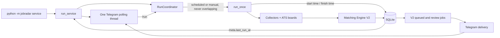
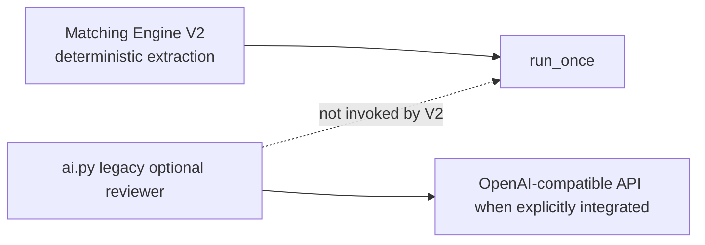
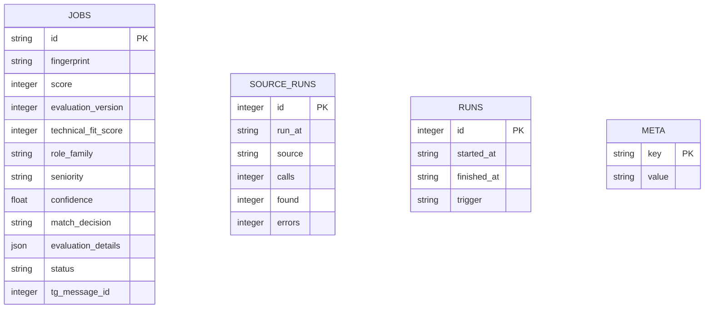

# 10 — Architecture diagrams

## Current production service



`last_run_at` is written before a non-dry run. A fresh database schedules the
first run immediately. A normal service restart calculates the remaining
configured interval from that value and does not immediately repeat the job
search. `last_run_finished_at` records successful completion; a missing/older
finish timestamp remains diagnostic evidence of an interrupted run.

## V2 evaluation and persistence

```mermaid
flowchart TD
  D[Normalized Job] --> R[Role classification]
  D --> X[Requirement extraction]
  CP[candidate_profile.yaml] --> SM[Skill matching]
  R --> SC[Role-aware scoring]
  X --> SM
  X --> SE[Seniority evaluation]
  SM --> SC
  SE --> SC
  SC --> E[TechnicalEvaluation
score 0-100 + confidence + evidence]
  E --> J[(jobs: additive V2 columns + JSON details)]
  E -->|strong/good| Q[queued]
  E -->|possible/insufficient information| RV[/review]
  E -->|poor or separate geographic exclusion| F[filtered]
```

The technical score is separate from geographic/work-authorization eligibility
and from user application status.

## AI boundary



`ai.py` parses constrained JSON, validates quoted infeasibility evidence, and
has rate-limit/failure circuit-breaker handling. Current V2 production runs do
not call it or combine its old score with normalized technical fit.

## Current database model



No declared foreign-key relationships exist. `meta` stores Telegram offsets,
watchdog state, and scheduling timestamps.
