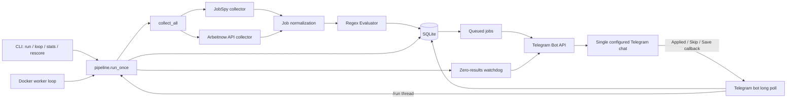
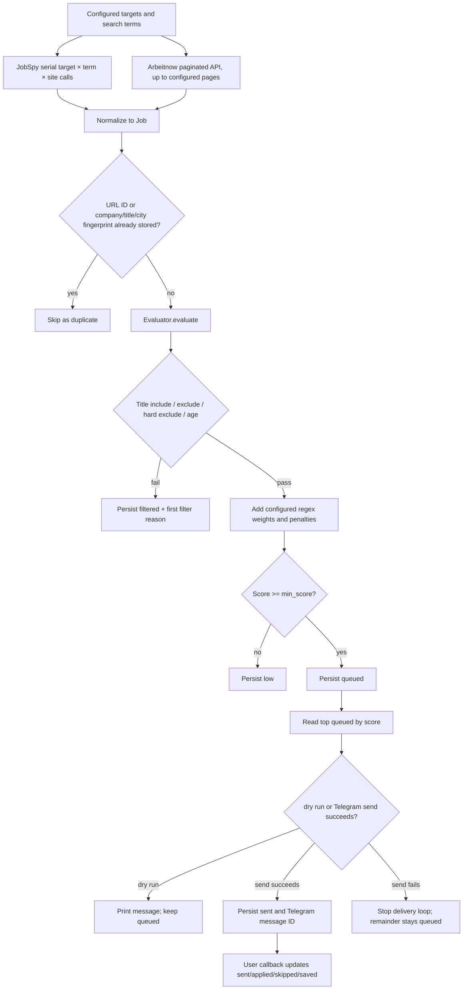
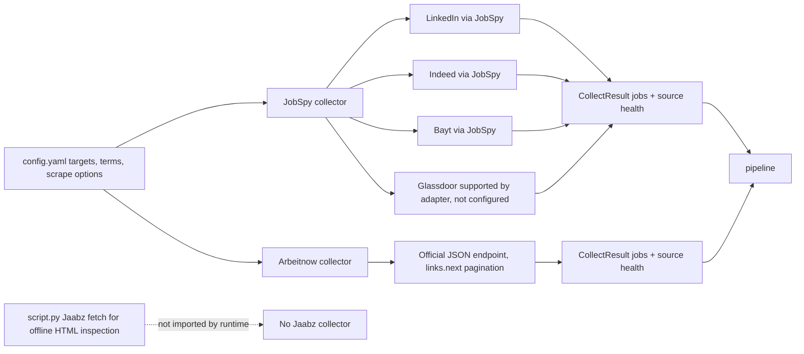
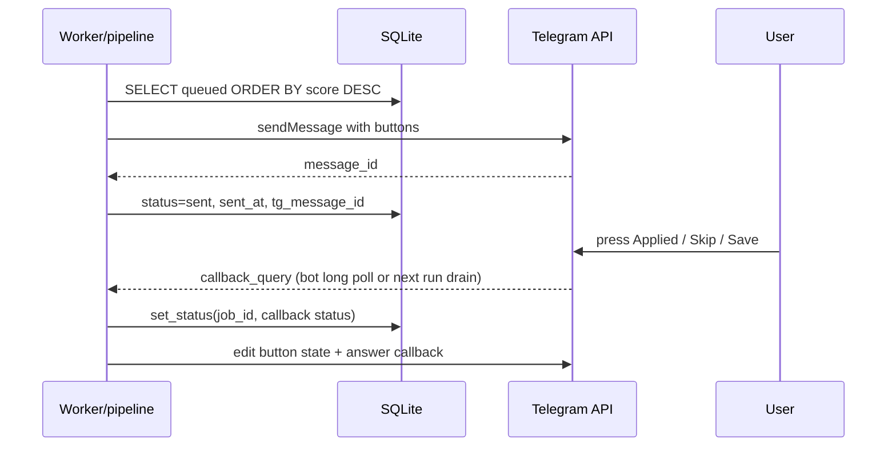
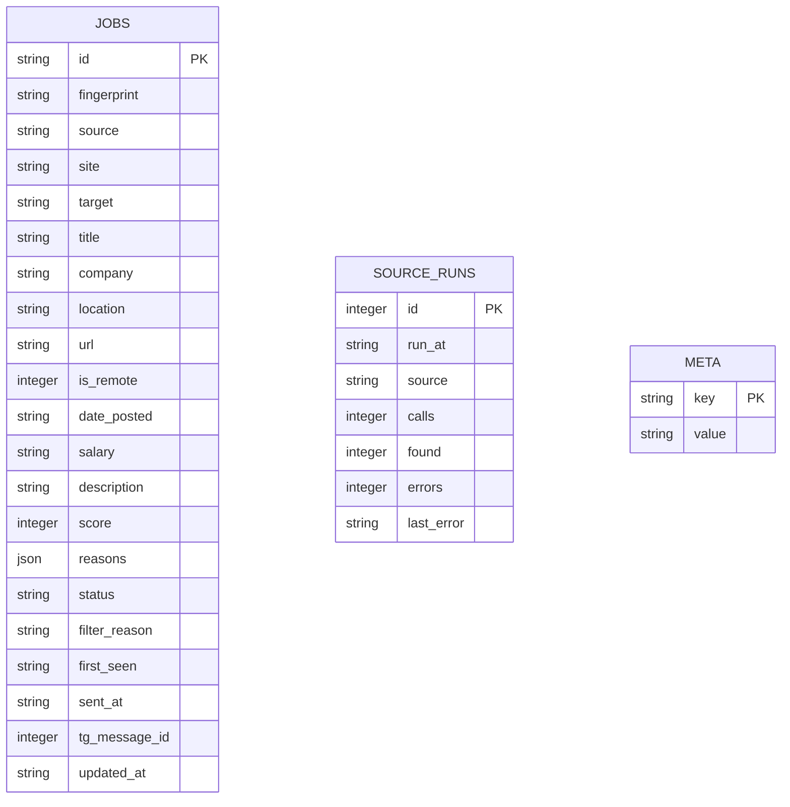
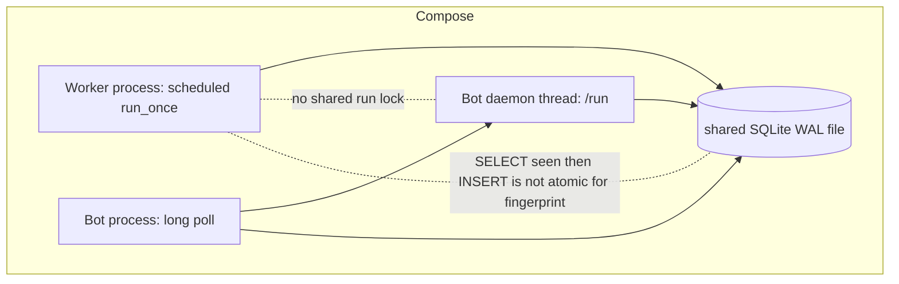
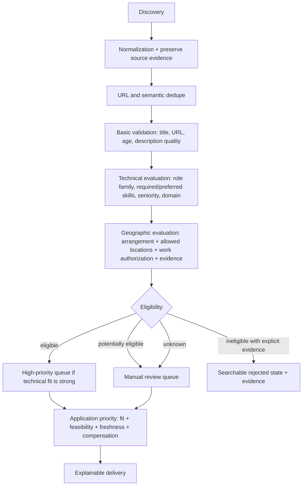
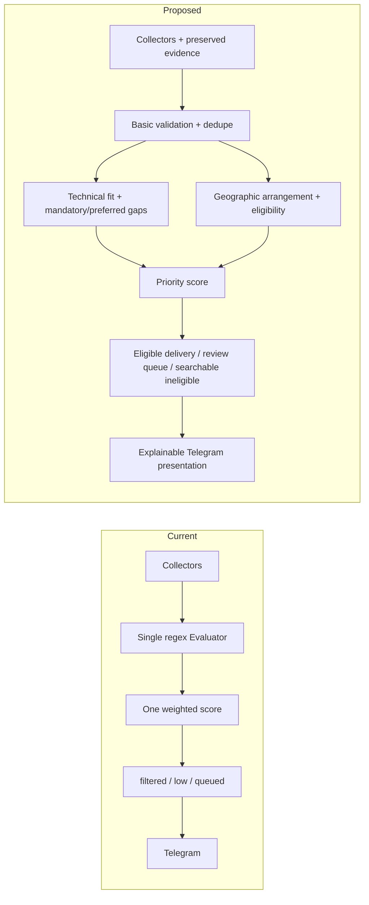

# 10 — Architecture diagrams

All diagrams labeled **current** reflect inspected code. The final diagram is explicitly proposed.

## Current high-level architecture



## Current job lifecycle



## Current source integrations



The source names from the user-provided source list that are not in the diagram have no active adapter in this checkout.

## Current Telegram callback sequence



Current implementation does not persist Telegram delivery attempts separately, and callback offsets advance after handler exceptions.

## Current database ER model



No declared foreign-key relationships exist among these tables.

## Current worker concurrency



## Proposed conceptual evaluation flow (future)



No current AI evaluator or separate technical/geographic stages exist; this diagram is a recommendation, not current architecture.

## Proposed AI evaluation sequence (future, optional)

```mermaid
sequenceDiagram
  participant P as Pipeline
  participant T as Technical policy
  participant G as Geographic policy
  participant M as Optional model
  participant V as Strict schema validator
  participant DB as SQLite
  P->>T: normalized job + candidate profile
  T->>T: deterministic role family, hard requirements, preferred skills
  T->>M: job description as untrusted data + bounded extraction request
  M-->>V: structured facts, gaps, evidence, confidence
  V->>V: enum/type/range/evidence validation
  alt invalid output or timeout
    V-->>T: mark semantic extraction unavailable; keep uncertain facts unknown
  else valid output
    V-->>T: validated extracted requirements and evidence
  end
  T->>G: technical assessment + geographic evidence
  G->>G: evaluate arrangement and candidate-country eligibility
  G->>DB: persist separate fit, feasibility, priority, evidence, decision
```

The model in this proposed sequence cannot declare legal eligibility without supporting evidence and must not override explicit deterministic disqualifiers. Model provider, prompts, persistence, and costs do not exist in current code.

## Current versus proposed architecture


